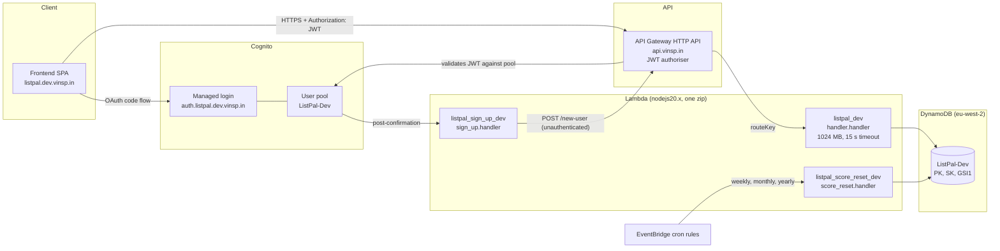
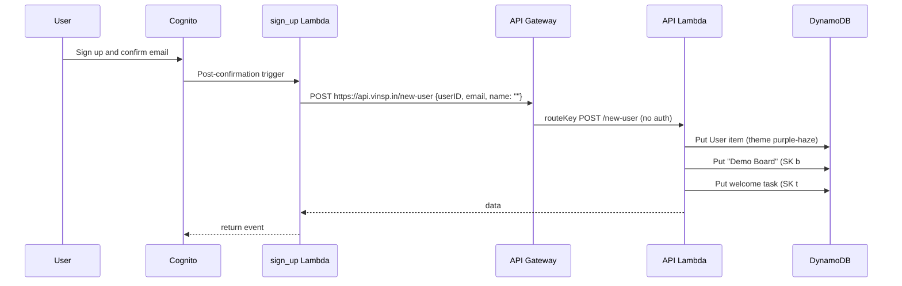
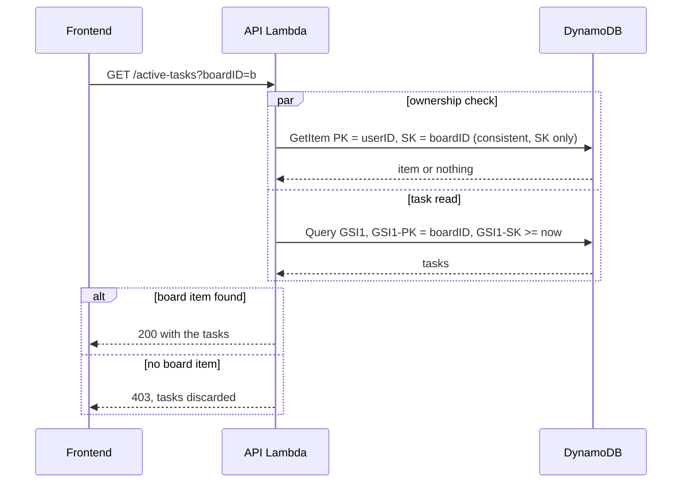
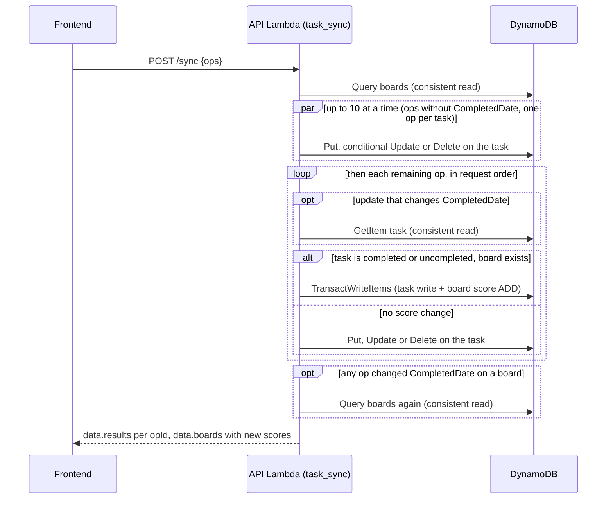
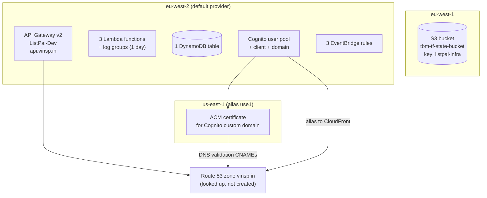
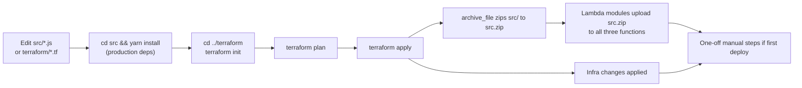
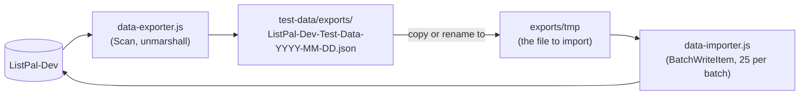

# ListPal Backend: Architecture and Infrastructure

This document is a condensed map of the `listpal-backend` repository. It is written so that a future reader (human or AI) can understand the system without reading every file. Facts were taken from the code on `main`. If the code has moved on, check the "Where to look" tables before trusting the detail.

## 1. Summary

ListPal is a task and goal tracking app. Users have **boards**, boards contain **tasks** grouped by **category**, and completing tasks earns **scores** (weekly, monthly, yearly) measured against **targets**.

The backend is fully serverless on AWS, defined in Terraform, and has no CI/CD pipeline. Everything is deployed by hand from a laptop.

| Concern | Choice |
| --- | --- |
| Compute | AWS Lambda, Node.js 20 (CommonJS) |
| API | API Gateway v2 (HTTP API), single Lambda integration |
| Auth | Cognito user pool, JWT authoriser, OAuth code flow with a custom domain |
| Data | DynamoDB, one table, single-table design |
| Scheduling | EventBridge (CloudWatch Events) cron rules |
| IaC | Terraform, S3 remote state |
| Environments | One only in practice: `Dev` (the `env` variable defaults to `Dev`) |

The frontend lives in a separate repository. It runs on `http://localhost:5173` locally and `https://listpal.dev.vinsp.in` when deployed (see the Cognito callback URLs).

## 2. Repository layout

```
listpal-backend/
├── README.md                  Only a list of useful links
├── ARCHITECTURE.md            This file
├── CLAUDE.md                  Working rules for AI assistants, including the documentation rules
├── src/                       All Lambda code (one shared package, one zip)
│   ├── handler.js             API Lambda: every HTTP route
│   ├── task_sync.js           Batch task sync (POST /sync), including score changes
│   ├── score_periods.js       Which score periods (W, M, Y) a completion counts towards
│   ├── score_reset.js         Cron Lambda: zeroes board scores
│   ├── sign_up.js             Cognito post-confirmation trigger
│   ├── package.json / yarn.lock
│   └── .tool-versions         nodejs 20.0.0
├── src.zip                    Build artefact written by Terraform (gitignored)
├── terraform/                 All infrastructure
│   ├── versions.tf            S3 backend and provider constraints
│   ├── providers.tf           AWS eu-west-2 plus alias use1 (us-east-1)
│   ├── variables.tf           env, app, domain_name, root_domain_zone
│   ├── locals.tf              Route table (lambda_routes) and common tags
│   ├── apigateway.tf          HTTP API, JWT authoriser, throttling, logs
│   ├── lambda.tf              API Lambda and the zip build
│   ├── signup.tf              Sign-up Lambda and Cognito invoke permission
│   ├── cronjob.tf             Score reset rules and Lambda
│   ├── cognito.tf             User pool, domain, client, seed users
│   ├── acm.tf / route53.tf    Certificate (us-east-1) and DNS for the login domain
│   ├── dynamodb.tf            Main table
│   ├── outputs.tf             api_endpoint
│   └── config/                db-schema.json (NoSQL Workbench model), db_import.json (seed data)
├── test/                      Unit tests, a separate package (node --test, aws-sdk-client-mock)
├── test-data/                 Manual DynamoDB export and import scripts, plus export files
└── bak/                       Old code kept for reference (gitignored, ignore it)
```

`bak/*` is in the root `.gitignore`, so it is not part of the deployed system. `terraform/builds/` is an empty leftover directory.

## 3. System architecture



### Request lifecycle

1. The frontend signs the user in through the Cognito managed login (authorisation code flow, scope `openid`).
2. Requests carry the token in the `Authorization` header.
3. API Gateway's JWT authoriser checks the token against the user pool and client ID. `POST /new-user` is the only route with no authoriser.
4. API Gateway invokes the single API Lambda with payload format 2.0. The Lambda switches on `event.routeKey`.
5. For protected routes the Lambda runs `jwtDecode` on the same header (decode only, no signature check, because the gateway has already verified it) and builds `userID = "u#" + sub`. All data access is scoped by this ID.
6. The Lambda returns `{ data: ... }` on success, which API Gateway sends as a 200. Errors go through a `respond(statusCode, payload)` helper: validation failures are 400, ownership failures 403, and anything caught by the top-level `catch` is 500.

### New user flow



The sign-up Lambda has the URL `https://api.vinsp.in/new-user` hard-coded, so it always calls the deployed API regardless of environment.

## 4. API routes

Routes are declared once in `terraform/locals.tf` (`lambda_routes`) and fed into API Gateway. Each maps to a `case` in `src/handler.js`. All routes go to the same Lambda.

| Route | Auth | Purpose |
| --- | --- | --- |
| `GET /active-tasks?boardID=` | JWT | Tasks for a board whose `GSI1-SK` is at or after now (ownership checked alongside the task query, 400 without `boardID`) |
| `GET /task?taskID=` | JWT | One task |
| `GET /boards` | JWT | All boards for the user, with scores, targets, emoji, category order |
| `GET /user` | JWT | User theme |
| `POST /new-user` | none | Create user, demo board and welcome task |
| `POST /sync` | JWT | Batch of up to 50 `create`, `update`, `delete` task ops (the main write path). Returns a status per op and the new scores of any board whose score changed. See "Task sync" below |
| `POST /user-theme` | JWT | Set theme |
| `POST /new-board`, `/rename-board`, `/board-emoji`, `/board-category-order` | JWT | Board edits |
| `POST /delete-board` | JWT | Deletes the board's active tasks, then the board (ownership checked) |
| `POST /board-scores` | JWT | Manual edit of `YScore`, `MScore`, `WScore` (non-negative numbers, ownership checked). Ticking tasks changes scores through `POST /sync` instead |
| `POST /board-targets` | JWT | Save `YTarget`, `MTarget`, `WTarget` |

### Board ownership check

`verifyBoard` is one strongly consistent `GetItem` on `(userID, boardID)`, projecting only `SK`. The ID must start `b#` and be longer than the prefix, so the user item, a task or a GSI1 partition key can't pass as a board. The read is consistent because the frontend can open or delete a board moments after creating it.

`POST /delete-board` and `POST /board-scores` run the check before writing anything. `GET /active-tasks` runs it at the same time as the task query, because ownership never changes and the tasks are discarded on a 403. The task query only starts for a well-formed board ID, so `"u#"` or `"b#"` (the GSI1 partitions holding every user and every board) are never read.



Commented-out routes (`all-tasks`, `expired-tasks`, `task-description`, `task-details`, `task-checked`, `task-important`, `new-task`, `delete-task`) were superseded by `sync`. Their code remains in `handler.js` as comments or unused functions.

Gateway settings: HTTP API, CORS open to all origins with preflights cacheable for 2 hours (`max_age = 7200`, so browsers skip the `OPTIONS` round trip on repeat requests), default throttling of 50 requests per second with a burst of 100, access logs to CloudWatch with one day retention.

### Task sync

`POST /sync` is the only path that creates, edits or deletes tasks from the client. The logic lives in `src/task_sync.js`. The handler validates the body (at most 50 ops, `ops` must be an array) and returns 400 on failure.



Each op is checked before it runs:

- `opId`, `SK` (must start `t#`), `kind`, and `boardID` (must be one of the user's boards) are required.
- `fields` must be on an allow-list. Anything else, including `PK`, is rejected.

Each op gets one status in `results`:

| Status | Meaning | Client action |
| --- | --- | --- |
| `applied` | Written | None |
| `rejected` | The op can never succeed (bad shape, foreign board, DynamoDB validation error) | Drop it |
| `retry` | Transient DynamoDB error | Send again later |
| `gone` | Update to a task that no longer exists | Drop it. No partial item is created |
| `conflict` | The task or board kept changing during two attempts | Keep it and retry later |

Behaviour that matters when changing this code:

- Ops that change `CompletedDate`, or repeat a task already in the batch, run one at a time in request order, after the others. Parallel transactions on the same board item would cancel each other, and repeated edits to one task must land in order. All other ops touch only their own task, so they run up to 10 at a time (`CONCURRENCY`). Results are returned in request order either way.
- A task completed this period adds 1 to every score field it still counts towards. Unticking takes 1 back, but never below zero. Periods come from `src/score_periods.js`, which must match the reset crons (see section 6).
- A create whose task already exists (an earlier attempt landed but the response was lost) is applied as an update, so scores are not counted twice.
- Only `CompletedDate` changes move scores. Edits to other fields never do.
- An update without `CompletedDate` is a single `UpdateItem` conditioned on `attribute_exists(SK)`, so a deleted task returns `gone` instead of coming back as a partial item. Only completion changes read the task first, because the score change depends on its current `CompletedDate`.
- A resent completion that an earlier attempt already applied changes no scores, but its board is still returned in `data.boards` with the current scores. The client may have read scores before that earlier attempt landed.

## 5. Data model

DynamoDB, on-demand style single-table patterns. The table has `PK` (S), `SK` (S), a global secondary index `GSI1` (`GSI1-PK`, `GSI1-SK`, projection ALL), and TTL on `ExpiryDateTTL`.

### `ListPal-{Env}` (main table)

| Entity | PK | SK | GSI1-PK | GSI1-SK | Key attributes |
| --- | --- | --- | --- | --- | --- |
| User | `u#<cognito sub>` | `u#<sub>` | `u#` | `u#<sub>` | `Email`, `Name`, `Theme` |
| Board | `u#<sub>` | `b#<uuid>` | `b#` | `b#<uuid>` | `Board`, `Emoji`, `CategoryOrder` (JSON string), `WScore/MScore/YScore`, `WTarget/MTarget/YTarget` (defaults 7, 31, 365) |
| Task | `u#<sub>` | `t#<uuid>` | `b#<boardUuid>` | expiry as epoch ms string, or `"nil"` | `Description`, `Category`, `Emoji`, `CreatedDate`, `CompletedDate`, `ExpiryDate`, `ExpiryDateTTL`, `Important`, `Link` |

Access patterns:

- Boards for a user: query `PK = u#...` and `begins_with(SK, "b#")`. Strongly consistent, because scores are read straight after a sync.
- One of the user's boards (ownership check): `GetItem` on `PK = u#...`, `SK = b#<id>`. Strongly consistent, because a board can be used straight after it is created.
- Active tasks for a board: query `GSI1` with `GSI1-PK = b#<id>` and `GSI1-SK >= now`. The string `"nil"` sorts after numeric strings, so tasks with no expiry stay "active".
- All boards across all users (used by the score reset): query `GSI1` with `GSI1-PK = "b#"`.

Reference material: `terraform/config/db-schema.json` is a NoSQL Workbench model and `db_import.json` is a small seed set. Both pre-date some later attributes.

## 6. Scheduled jobs

```mermaid
gantt
    title Monday UTC schedule
    dateFormat HH:mm
    axisFormat %H:%M
    section Jobs
    Score reset (also runs 1st of month and 1 Jan) :00:00, 10m
```



| Rule name | Cron (UTC) | Target | Behaviour |
| --- | --- | --- | --- |
| `listpal_weekly_score_reset_dev` | `0 0 ? * MON *` | `score_reset` | Queries all boards via `GSI1`, sets `WScore = 0` |
| `listpal_monthly_score_reset_dev` | `0 0 1 * ? *` | `score_reset` | Sets `MScore = 0` |
| `listpal_yearly_score_reset_dev` | `0 0 1 1 ? *` | `score_reset` | Sets `YScore = 0` |

`score_reset.js` picks the field to reset by checking whether the triggering rule's ARN (`event.resources[0]`) contains `weekly`, `monthly` or `yearly`. Renaming a rule would break this. It writes one board at a time and has a default Lambda timeout, so it will not scale to very many boards.

The API side keeps its own copy of the period boundaries in `src/score_periods.js`, used by `POST /sync` to decide whether a completion still counts. The boundaries (Monday, 1st of month, 1 January, 00:00 UTC) must match these cron rules. If the crons change, change that file too.

## 7. Infrastructure detail



Key points:

- **State backend:** S3 bucket `tbm-tf-state-bucket` in `eu-west-1`, key `listpal-infra`. No DynamoDB lock table is configured, so concurrent applies are not protected.
- **Providers:** AWS `eu-west-2` by default, plus alias `use1` (`us-east-1`) because Cognito custom domains need a certificate in that region. Also requires `random`, `local`, `null`. The `archive` provider is used implicitly by `data "archive_file"`.
- **Terraform version:** `.tool-versions` pins 1.3.0 (`required_version >= 1.3`). AWS provider `>= 5.21`.
- **Community modules:** `terraform-aws-modules/lambda/aws ~> 7.0`, `apigateway-v2/aws 5.0.0`, `dynamodb-table/aws 4.0.0`.
- **Domains:** The API is served at `api.vinsp.in` (module `domain_name = "*.vinsp.in"`, `subdomains = ["api"]`). The Cognito managed login is at `auth.listpal.dev.vinsp.in`. The Route 53 hosted zone `vinsp.in` must already exist.
- **Naming:** `${app}-${env}` for tables, pool and API; `${lower(app)}_${lower(env)}` for Lambdas. Changing `env` creates a parallel stack, but the domains, callback URLs and the sign-up URL are hard-coded to the `dev` setup, so a second environment needs those parameterising first.
- **IAM:** Each Lambda has an inline policy with `Resource: "*"`.
  - API Lambda: `Query`, `GetItem`, `UpdateItem`, `PutItem`, `DeleteItem` plus stream actions.
  - Score reset: `Query`, `UpdateItem`.
  - Sign-up: no extra policy (it only calls the public API).
- **Logging:** Lambda and API access log groups keep logs for one day only.

## 8. Deployment

There is no pipeline. Deployment is `terraform apply` from a machine with AWS credentials for the target account.



### Standard code or infra change

```sh
cd src
yarn install            # node_modules is gitignored but must exist, it goes into the zip
cd ../terraform
terraform init          # first time, or after changing providers or modules
terraform plan
terraform apply
```

How the code packaging works:

- `data "archive_file" "api_lambda"` zips the whole of `src/` (including `node_modules`) to `src.zip` in the repo root.
- All three Lambdas use `create_package = false` and `local_existing_package = ../src.zip`. They run the same artefact and differ only by `handler` (`handler.handler`, `sign_up.handler` and `score_reset.handler`).
- Because the zip contains everything, a change to any file in `src/` redeploys all three functions.
- If a code change does not appear to deploy, check that `src.zip` was regenerated during the plan. The Lambda modules take the zip path as a plain string, so there is no explicit dependency on the `archive_file` resource.

### First-time deployment extras

1. **State bucket:** `tbm-tf-state-bucket` must already exist in `eu-west-1`.
2. **DNS zone:** the `vinsp.in` Route 53 zone must exist.
3. **Managed login:** after the Cognito domain is created, the new managed login UI must be switched on in the AWS console (noted in a comment in `cognito.tf`).
4. **Cognito users:** `cognito.tf` creates three seed users (`admin@`, `tom@`, `adam@example.com`). See the security notes below before using this anywhere real.
5. **Seed data (optional):** `terraform/config/db_import.json` or an export from `test-data/` can be loaded with the importer.

### Outputs

`terraform output api_endpoint` returns the raw `execute-api` URL.

### Local development

There is no local runtime in this repo. The `localdb-functionality` branch (merged in PR #5) relates to the frontend's local database and does not add backend tooling. The `test-data/` scripts talk to the real `ListPal-Dev` table in `eu-west-2`.

Unit tests live in `test/`, a separate package so test-only dependencies stay out of the Lambda zip. Run `yarn install && yarn test` inside it. DynamoDB is mocked, so the tests need no AWS access.

## 9. Backups and data recovery

**There is no automated backup of any kind.** Searching the Terraform for point-in-time recovery, AWS Backup, or on-demand backup resources finds nothing. Specifically:

| Item | State |
| --- | --- |
| DynamoDB point-in-time recovery | Not enabled |
| AWS Backup plans or vaults | None |
| Scheduled exports to S3 | None |
| `deletion_protection_enabled` | `false` |
| Cross-region replication (global tables) | None |
| Terraform state | In S3; versioning is not managed by this repo, so confirm it in the bucket settings |

The only backups are **manual JSON exports** taken with scripts in `test-data/`:



### Taking a backup

```sh
cd test-data
yarn install   # or npm install; ESM project ("type": "module")
node data-exporter.js  # writes exports/ListPal-Dev-Test-Data-<date>.json
```

### Restoring

```sh
cp exports/ListPal-Dev-Test-Data-<date>.json exports/tmp
node data-importer.js   # writes to ListPal-Dev
```

### Limitations to be aware of

- The exporter uses a single `Scan` with no pagination, so they stop at 1 MB of data per run. The table is small today but this will silently truncate once it grows.
- The importer reads `./exports/tmp`, targets the hard-coded table `ListPal-Dev`, and does not retry `UnprocessedItems`.
- The scripts have a hard-coded table name and region (`eu-west-2`), so they back up Dev only.
- `test-data/*` is in the root `.gitignore`, but earlier exports were committed before that rule existed, so they are tracked. Exports contain real email addresses and task text. Treat them as personal data.
- TTL deletes (expired tasks) are permanent and not recoverable without PITR.

Recommended improvements, if wanted: enable `point_in_time_recovery_enabled = true` on the table, enable `deletion_protection_enabled`, and add an AWS Backup plan. These are one-line changes in `dynamodb.tf` for the module.

## 10. Security and quality observations

These are things a reader should know before changing the system. They are not fixed in the code.

- `cognito.tf` creates users with hard-coded passwords in the repository. Remove or randomise these for anything beyond throwaway development.
- `POST /new-user` is unauthenticated and trusts the `userID`, `email` and `name` in the body. Anyone can create user, board and task records for an arbitrary ID. Securing it (for example with an IAM-authorised direct Lambda invoke from the Cognito trigger rather than a public HTTP call) would be better.
- IAM policies use `Resource: "*"` and include stream actions the table does not use. They should be scoped to the table ARN.
- CORS allows every origin.
- The API Lambda trusts the gateway for token validation and only decodes the JWT.
- Batches are not atomic. Each `POST /sync` op stands alone, so a batch can partly apply, and the client must act on the per-op `results`. Board deletion is a plain loop with no transaction.
- `delete-board` only deletes tasks that appear in `activeTasksQuery` (not expired ones), so expired tasks can be orphaned until their TTL removes them.
- A git commit message says the cron moved to 3:00 AM, but the Terraform currently says 00:00 UTC for score resets. Trust the Terraform.

## 11. Where to look

| I want to... | Go to |
| --- | --- |
| Add or change an API route | `terraform/locals.tf` (`lambda_routes`) and a `case` in `src/handler.js` |
| Change DynamoDB queries or item shapes | Query builder functions at the bottom of `src/handler.js` |
| Change throttling, CORS or authoriser | `terraform/apigateway.tf` |
| Change Lambda runtime, memory or permissions | `terraform/lambda.tf`, `cronjob.tf`, `signup.tf` |
| Change cron schedules | `terraform/cronjob.tf` (`crons`), and `src/score_periods.js` to match |
| Change how task edits affect scores | `src/task_sync.js` (`POST /sync`) |
| Change auth, callback URLs or tokens | `terraform/cognito.tf` |
| Change domains or certificates | `terraform/acm.tf`, `route53.tf`, `variables.tf` |
| Back up or restore data | `test-data/` (section 9) |
