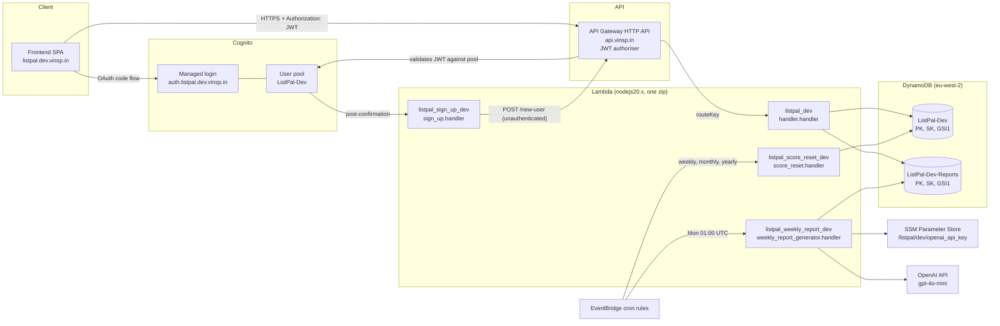
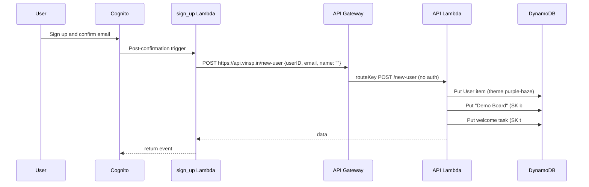
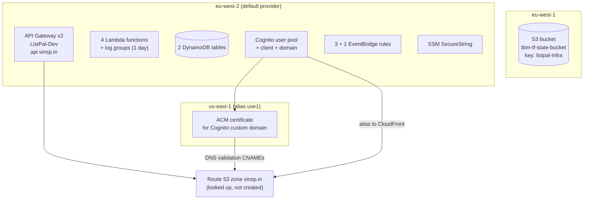
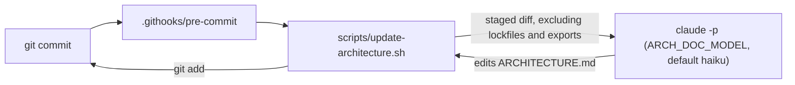
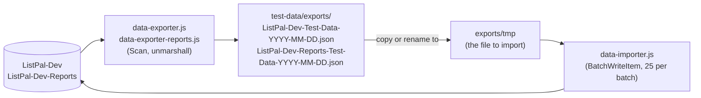

# ListPal Backend: Architecture and Infrastructure

This document is a condensed map of the `listpal-backend` repository. It is written so that a future reader (human or AI) can understand the system without reading every file. Facts were taken from the code on `main`. If the code has moved on, check the "Where to look" tables before trusting the detail.

## 1. Summary

ListPal is a task and goal tracking app. Users have **boards**, boards contain **tasks** grouped by **category**, and completing tasks earns **scores** (weekly, monthly, yearly) measured against **targets**. Once a week an LLM writes a playful summary of what each user completed.

The backend is fully serverless on AWS, defined in Terraform, and has no CI/CD pipeline. Everything is deployed by hand from a laptop.

| Concern | Choice |
| --- | --- |
| Compute | AWS Lambda, Node.js 20 (CommonJS) |
| API | API Gateway v2 (HTTP API), single Lambda integration |
| Auth | Cognito user pool, JWT authoriser, OAuth code flow with a custom domain |
| Data | DynamoDB, two tables, single-table design per table |
| Scheduling | EventBridge (CloudWatch Events) cron rules |
| Secrets | SSM Parameter Store (OpenAI key) |
| IaC | Terraform, S3 remote state |
| AI | OpenAI `gpt-4o-mini` for weekly summaries |
| Environments | One only in practice: `Dev` (the `env` variable defaults to `Dev`) |

The frontend lives in a separate repository. It runs on `http://localhost:5173` locally and `https://listpal.dev.vinsp.in` when deployed (see the Cognito callback URLs).

## 2. Repository layout

```
listpal-backend/
├── README.md                  Only a list of useful links
├── ARCHITECTURE.md            This file
├── CLAUDE.md                  Working rules for AI assistants, including the documentation rules
├── .githooks/
│   └── pre-commit             Runs scripts/update-architecture.sh (enable per clone, see section 8)
├── scripts/
│   └── update-architecture.sh Refreshes this file from the staged diff using a cheap model
├── src/                       All Lambda code (one shared package, one zip)
│   ├── handler.js             API Lambda: every HTTP route (945 lines)
│   ├── score_reset.js         Cron Lambda: zeroes board scores
│   ├── weekly_report_generator.js  Cron Lambda: OpenAI weekly summaries
│   ├── sign_up.js             Cognito post-confirmation trigger
│   ├── package.json / yarn.lock
│   └── .tool-versions         nodejs 20.0.0
├── src.zip                    Build artefact written by Terraform (gitignored)
├── terraform/                 All infrastructure
│   ├── versions.tf            S3 backend and provider constraints
│   ├── providers.tf           AWS eu-west-2 plus alias use1 (us-east-1)
│   ├── variables.tf           env, app, domain_name, root_domain_zone, openai_api_key
│   ├── locals.tf              Route table (lambda_routes) and common tags
│   ├── apigateway.tf          HTTP API, JWT authoriser, throttling, logs
│   ├── lambda.tf              API Lambda and the zip build
│   ├── signup.tf              Sign-up Lambda and Cognito invoke permission
│   ├── cronjob.tf             Score reset rules and Lambda
│   ├── weekly_report.tf       Weekly report rule, Lambda, SSM parameter
│   ├── cognito.tf             User pool, domain, client, seed users
│   ├── acm.tf / route53.tf    Certificate (us-east-1) and DNS for the login domain
│   ├── dynamodb.tf            Both tables
│   ├── outputs.tf             api_endpoint
│   └── config/                db-schema.json (NoSQL Workbench model), db_import.json (seed data)
├── test-data/                 Manual DynamoDB export and import scripts, plus export files
└── bak/                       Old code kept for reference (gitignored, ignore it)
```

`bak/*` is in the root `.gitignore`, so it is not part of the deployed system. `terraform/builds/` is an empty leftover directory.

## 3. System architecture



### Request lifecycle

1. The frontend signs the user in through the Cognito managed login (authorisation code flow, scope `openid`).
2. Requests carry the token in the `Authorization` header.
3. API Gateway's JWT authoriser checks the token against the user pool and client ID. `POST /new-user` is the only route with no authoriser.
4. API Gateway invokes the single API Lambda with payload format 2.0. The Lambda switches on `event.routeKey`.
5. For protected routes the Lambda runs `jwtDecode` on the same header (decode only, no signature check, because the gateway has already verified it) and builds `userID = "u#" + sub`. All data access is scoped by this ID.
6. The Lambda returns `{ data: ... }`. Note that errors are frequently returned as a normal 200 response containing an `error` key rather than a non-2xx status.

### New user flow



The sign-up Lambda has the URL `https://api.vinsp.in/new-user` hard-coded, so it always calls the deployed API regardless of environment.

## 4. API routes

Routes are declared once in `terraform/locals.tf` (`lambda_routes`) and fed into API Gateway. Each maps to a `case` in `src/handler.js`. All routes go to the same Lambda.

| Route | Auth | Purpose |
| --- | --- | --- |
| `GET /active-tasks?boardID=` | JWT | Tasks for a board whose `GSI1-SK` is at or after now (checks board ownership first) |
| `GET /task?taskID=` | JWT | One task |
| `GET /boards` | JWT | All boards for the user, with scores, targets, emoji, category order |
| `GET /user` | JWT | User theme |
| `GET /weekly-reports` | JWT | Up to 10 `rl#` report lines (Reports table) |
| `GET /stats` | JWT | Score, `WOTY`, `YearNum` for each report line |
| `POST /new-user` | none | Create user, demo board and welcome task |
| `POST /task-sync` | JWT | Batch of `create`, `update`, `delete` task actions (the main write path) |
| `POST /rename-category` | JWT | Update `Category` on a list of task IDs |
| `POST /user-theme` | JWT | Set theme |
| `POST /new-board`, `/rename-board`, `/board-emoji`, `/board-category-order` | JWT | Board edits |
| `POST /delete-board` | JWT | Deletes the board's active tasks, then the board (ownership checked) |
| `POST /card-emoji` | JWT | Update emoji on a list of task IDs |
| `POST /board-scores` | JWT | Save `YScore`, `MScore`, `WScore`; optionally add or remove the task in the Reports table |
| `POST /board-targets` | JWT | Save `YTarget`, `MTarget`, `WTarget` |

Commented-out routes (`all-tasks`, `expired-tasks`, `task-description`, `task-details`, `task-checked`, `task-important`, `new-task`, `delete-task`) were superseded by `task-sync`. Their code remains in `handler.js` as comments or unused functions.

Gateway settings: HTTP API, CORS open to all origins, default throttling of 10 requests per second with a burst of 10, access logs to CloudWatch with one day retention.

## 5. Data model

DynamoDB, on-demand style single-table patterns. Both tables have `PK` (S), `SK` (S), a global secondary index `GSI1` (`GSI1-PK`, `GSI1-SK`, projection ALL), and TTL on `ExpiryDateTTL`.

### `ListPal-{Env}` (main table)

| Entity | PK | SK | GSI1-PK | GSI1-SK | Key attributes |
| --- | --- | --- | --- | --- | --- |
| User | `u#<cognito sub>` | `u#<sub>` | `u#` | `u#<sub>` | `Email`, `Name`, `Theme` |
| Board | `u#<sub>` | `b#<uuid>` | `b#` | `b#<uuid>` | `Board`, `Emoji`, `CategoryOrder` (JSON string), `WScore/MScore/YScore`, `WTarget/MTarget/YTarget` (defaults 7, 31, 365) |
| Task | `u#<sub>` | `t#<uuid>` | `b#<boardUuid>` | expiry as epoch ms string, or `"nil"` | `Description`, `Category`, `Emoji`, `CreatedDate`, `CompletedDate`, `ExpiryDate`, `ExpiryDateTTL`, `Important`, `Link` |

Access patterns:

- Boards for a user: query `PK = u#...` and `begins_with(SK, "b#")`.
- Active tasks for a board: query `GSI1` with `GSI1-PK = b#<id>` and `GSI1-SK >= now`. The string `"nil"` sorts after numeric strings, so tasks with no expiry stay "active".
- All boards across all users (used by the score reset): query `GSI1` with `GSI1-PK = "b#"`.

### `ListPal-{Env}-Reports`

| Entity | PK | SK | Notes |
| --- | --- | --- | --- |
| Completed task (staging for report) | `t#` | `t#<taskUuid>` | `UserID`, `Description`, `Category`, `Emoji`, `ExpiryDateTTL` = next Monday plus one hour, so rows vanish after the weekly run |
| ReportLine | `u#<sub>` | `rl#<uuid>` | `Score` (tasks completed), `Summary` (JSON string of `{summaries:[{category, summary}]}`), `WOTY` (week of year), `YearNum` |

Reference material: `terraform/config/db-schema.json` is a NoSQL Workbench model and `db_import.json` is a small seed set. Both pre-date the Reports table and some later attributes.

## 6. Scheduled jobs

```mermaid
gantt
    title Monday UTC schedule
    dateFormat HH:mm
    axisFormat %H:%M
    section Jobs
    Score reset (also runs 1st of month and 1 Jan) :00:00, 10m
    Weekly AI report :01:00, 10m
```



| Rule name | Cron (UTC) | Target | Behaviour |
| --- | --- | --- | --- |
| `listpal_weekly_score_reset_dev` | `0 0 ? * MON *` | `score_reset` | Queries all boards via `GSI1`, sets `WScore = 0` |
| `listpal_monthly_score_reset_dev` | `0 0 1 * ? *` | `score_reset` | Sets `MScore = 0` |
| `listpal_yearly_score_reset_dev` | `0 0 1 1 ? *` | `score_reset` | Sets `YScore = 0` |
| `listpal_weekly_report_dev` | `0 1 ? * MON *` | `weekly_report_generator` | See below |

`score_reset.js` picks the field to reset by checking whether the triggering rule's ARN (`event.resources[0]`) contains `weekly`, `monthly` or `yearly`. Renaming a rule would break this. It writes one board at a time and has a default Lambda timeout, so it will not scale to very many boards.

`weekly_report_generator.js` (20 second timeout):

1. Reads the OpenAI key from SSM (`OPENAI_API_KEY_PATH`, decrypted).
2. Queries all staged tasks (`PK = t#`) from the Reports table.
3. Groups by user, flattens into a category-to-descriptions prompt, and calls `gpt-4o-mini` (temperature 0.8, structured output via Zod).
4. Writes one `ReportLine` per user with the task count as `Score`.

Known quirk: the prompt is built from every user's tasks merged together, and the same summary is then stored for every user. That is probably unintended.

## 7. Infrastructure detail



Key points:

- **State backend:** S3 bucket `tbm-tf-state-bucket` in `eu-west-1`, key `listpal-infra`. No DynamoDB lock table is configured, so concurrent applies are not protected.
- **Providers:** AWS `eu-west-2` by default, plus alias `use1` (`us-east-1`) because Cognito custom domains need a certificate in that region. Also requires `random`, `local`, `null`. The `archive` provider is used implicitly by `data "archive_file"`.
- **Terraform version:** `.tool-versions` pins 1.3.0 (`required_version >= 1.3`). AWS provider `>= 5.21`.
- **Community modules:** `terraform-aws-modules/lambda/aws ~> 7.0`, `apigateway-v2/aws 5.0.0`, `dynamodb-table/aws 4.0.0`.
- **Domains:** The API is served at `api.vinsp.in` (module `domain_name = "*.vinsp.in"`, `subdomains = ["api"]`). The Cognito managed login is at `auth.listpal.dev.vinsp.in`. The Route 53 hosted zone `vinsp.in` must already exist.
- **Naming:** `${app}-${env}` for tables, pool and API; `${lower(app)}_${lower(env)}` for Lambdas. Changing `env` creates a parallel stack, but the domains, callback URLs and the sign-up URL are hard-coded to the `dev` setup, so a second environment needs those parameterising first.
- **IAM:** Each Lambda has an inline policy with `Resource: "*"`.
  - API Lambda: `Query`, `UpdateItem`, `PutItem`, `DeleteItem` plus stream actions.
  - Score reset: `Query`, `UpdateItem`.
  - Weekly report: `Query`, `PutItem`, `ssm:GetParameter(s)`.
  - Sign-up: no extra policy (it only calls the public API).
- **Secrets:** `aws_ssm_parameter.openai_api_key` is created with the value `placeholder` and `ignore_changes = [value]`. The real key is set by hand (see deployment). The `openai_api_key` Terraform variable exists but is not used by any resource.
- **Logging:** Lambda and API access log groups keep logs for one day only.

## 8. Deployment

There is no pipeline. Deployment is `terraform apply` from a machine with AWS credentials for the target account.


### Standard code or infra change

```sh
cd src
yarn install            # node_modules is gitignored but must exist, it goes into the zip
cd ../terraform
terraform init          # first time, or after changing providers or modules
terraform plan
terraform apply
```

How the code packaging works:

- `data "archive_file" "api_lambda"` zips the whole of `src/` (including `node_modules`) to `src.zip` in the repo root.
- All four Lambdas use `create_package = false` and `local_existing_package = ../src.zip`. They run the same artefact and differ only by `handler` (`handler.handler`, `sign_up.handler`, `score_reset.handler`, `weekly_report_generator.handler`).
- Because the zip contains everything, a change to any file in `src/` redeploys all four functions.
- If a code change does not appear to deploy, check that `src.zip` was regenerated during the plan. The Lambda modules take the zip path as a plain string, so there is no explicit dependency on the `archive_file` resource.

### First-time deployment extras

1. **State bucket:** `tbm-tf-state-bucket` must already exist in `eu-west-1`.
2. **DNS zone:** the `vinsp.in` Route 53 zone must exist.
3. **Managed login:** after the Cognito domain is created, the new managed login UI must be switched on in the AWS console (noted in a comment in `cognito.tf`).
4. **OpenAI key:** replace the placeholder, for example:
   ```sh
   aws ssm put-parameter --region eu-west-2 --name /listpal/dev/openai_api_key \
     --type SecureString --overwrite --value '<key>'
   ```
5. **Cognito users:** `cognito.tf` creates three seed users (`admin@`, `tom@`, `adam@example.com`). See the security notes below before using this anywhere real.
6. **Seed data (optional):** `terraform/config/db_import.json` or an export from `test-data/` can be loaded with the importer.

### Outputs

`terraform output api_endpoint` returns the raw `execute-api` URL.

### Local development

There is no local runtime in this repo. The `localdb-functionality` branch (merged in PR #5) relates to the frontend's local database and does not add backend tooling. The `test-data/` scripts talk to the real `ListPal-Dev` tables in `eu-west-2`. The `src/package.json` has no real test script.

### Keeping this document current

A pre-commit hook asks a cheap model to update this file from the staged diff, and stages the result into the same commit. The hook is opt-in per clone:

```sh
git config core.hooksPath .githooks
```



The script never blocks a commit. If the `claude` CLI is missing or the model call fails, it prints a warning and the commit goes ahead without a documentation update. Use `git commit --no-verify` to skip the hook in an emergency, then correct this file by hand.

## 9. Backups and data recovery

**There is no automated backup of any kind.** Searching the Terraform for point-in-time recovery, AWS Backup, or on-demand backup resources finds nothing. Specifically:

| Item | State |
| --- | --- |
| DynamoDB point-in-time recovery | Not enabled on either table |
| AWS Backup plans or vaults | None |
| Scheduled exports to S3 | None |
| `deletion_protection_enabled` | `false` on both tables |
| Cross-region replication (global tables) | None |
| Terraform state | In S3; versioning is not managed by this repo, so confirm it in the bucket settings |

The only backups are **manual JSON exports** taken with scripts in `test-data/`:



### Taking a backup

```sh
cd test-data
yarn install   # or npm install; ESM project ("type": "module")
node data-exporter.js          # writes exports/ListPal-Dev-Test-Data-<date>.json
node data-exporter-reports.js  # writes exports/ListPal-Dev-Reports-Test-Data-<date>.json
```

### Restoring

```sh
cp exports/ListPal-Dev-Test-Data-<date>.json exports/tmp
node data-importer.js   # writes to ListPal-Dev
```

### Limitations to be aware of

- Exporters use a single `Scan` with no pagination, so they stop at 1 MB of data per run. The table is small today but this will silently truncate once it grows.
- The importer reads `./exports/tmp`, targets the hard-coded table `ListPal-Dev`, and does not retry `UnprocessedItems`. The reports table cannot be restored without editing the script.
- The scripts have a hard-coded table name and region (`eu-west-2`), so they back up Dev only.
- `test-data/*` is in the root `.gitignore`, but earlier exports were committed before that rule existed, so they are tracked. Exports contain real email addresses and task text. Treat them as personal data.
- TTL deletes (expired tasks and staged report tasks) are permanent and not recoverable without PITR.

Recommended improvements, if wanted: enable `point_in_time_recovery_enabled = true` on both tables, enable `deletion_protection_enabled`, and add an AWS Backup plan. These are one-line changes in `dynamodb.tf` for the module.

## 10. Security and quality observations

These are things a reader should know before changing the system. They are not fixed in the code.

- `cognito.tf` creates users with hard-coded passwords in the repository. Remove or randomise these for anything beyond throwaway development.
- `POST /new-user` is unauthenticated and trusts the `userID`, `email` and `name` in the body. Anyone can create user, board and task records for an arbitrary ID. Securing it (for example with an IAM-authorised direct Lambda invoke from the Cognito trigger rather than a public HTTP call) would be better.
- IAM policies use `Resource: "*"` and include stream actions the tables do not use. They should be scoped to the table ARNs.
- CORS allows every origin.
- The API Lambda trusts the gateway for token validation and only decodes the JWT.
- Errors are often returned as HTTP 200 with an `error` field, and the top-level `catch` in `handler.js` logs and returns nothing.
- Several writes are non-atomic loops or `Promise.all` batches with no transaction (task sync, rename category, board deletion).
- `delete-board` only deletes tasks that appear in `activeTasksQuery` (not expired ones), so expired tasks can be orphaned until their TTL removes them.
- A git commit message says the cron moved to 3:00 AM, but the Terraform currently says 01:00 UTC for the report and 00:00 UTC for score resets. Trust the Terraform.
- The weekly report staging TTL (next Monday plus one hour) is close to the 01:00 UTC report run, so there is a narrow window in which rows could expire before they are summarised.

## 11. Where to look

| I want to... | Go to |
| --- | --- |
| Add or change an API route | `terraform/locals.tf` (`lambda_routes`) and a `case` in `src/handler.js` |
| Change DynamoDB queries or item shapes | Query builder functions at the bottom of `src/handler.js` |
| Change throttling, CORS or authoriser | `terraform/apigateway.tf` |
| Change Lambda runtime, memory or permissions | `terraform/lambda.tf`, `cronjob.tf`, `weekly_report.tf`, `signup.tf` |
| Change cron schedules | `terraform/cronjob.tf` (`crons`), `terraform/weekly_report.tf` |
| Change the AI prompt or model | `getAISummary` in `src/weekly_report_generator.js` |
| Change auth, callback URLs or tokens | `terraform/cognito.tf` |
| Change domains or certificates | `terraform/acm.tf`, `route53.tf`, `variables.tf` |
| Back up or restore data | `test-data/` (section 9) |
| Change how this document is maintained | `.githooks/pre-commit`, `scripts/update-architecture.sh`, `CLAUDE.md` |
